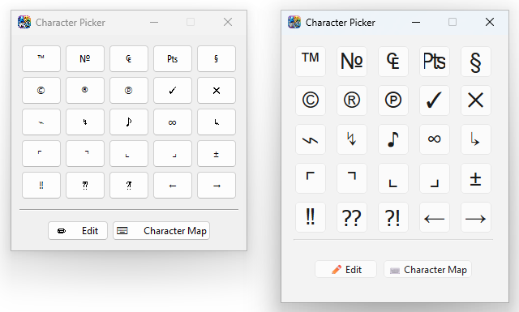

<p align="center">
  
</p>

<h1 align="center">Character Picker</h1>

<p align="center">
  A lightweight, always-on-top desktop tool for copying special characters to the clipboard with a single click.
</p>

<p align="center">
  
  
  
  
  
</p>

---

## ✨ Features

- **5 × 5 customisable grid** of special characters — click any character to copy it to the clipboard instantly
- **Edit mode** — replace any character in the grid with your own; changes are saved automatically
- **Persistent settings** — your custom character set is stored in `character_settings.json` next to the executable
- **System Character Map** — one-click shortcut to open Windows `charmap.exe`
- **Minimal footprint** — compact fixed-size window, no unnecessary dependencies
- **Single-file EXE** — distributed as a standalone executable (no Python installation required)

---

## 📋 Default Character Set

| | Col 1 | Col 2 | Col 3 | Col 4 | Col 5 |
|---|:---:|:---:|:---:|:---:|:---:|
| **Row 1** | ™ | № | ₠ | ₧ | § |
| **Row 2** | © | ® | ℗ | ✓ | ✕ |
| **Row 3** | ⌁ | ↯ | ♪ | ∞ | ↳ |
| **Row 4** | ⌜ | ⌝ | ⌞ | ⌟ | ± |
| **Row 5** | ‼ | ⁇ | ⁈ | ← | → |

---

## 🚀 Getting Started

### Prerequisites

| Requirement | Version |
|---|---|
| Python | 3.9 or newer |
| PyQt6 | 6.x |

### Installation

```bash
# Clone the repository
git clone https://github.com/polsoft-it/character-picker.git
cd character-picker

# Install dependencies
pip install PyQt6

# Run the application
python character_picker_pyqt.py
```

### Download pre-built EXE

Head over to the [Releases](https://github.com/polsoft-it/character-picker/releases) page and download the latest `character_picker_pyqt.exe` — no Python required.

---

## 🏗️ Build from Source

Build scripts and PyInstaller spec files are located in `.dev/`.

### PyQt6 build (recommended)

```bat
.dev\PyQt6\build.bat
```

### Tkinter build (legacy)

```bat
.dev\tkinter\build.bat
```

> **Tip:** Install [UPX](https://github.com/upx/upx/releases) and add it to your `PATH` before building — the build script will detect it automatically and compress the EXE to ~20–25 MB.

Build output is placed in `.dev\<variant>\dist\`.

---

## 📁 Project Structure

```
Character Picker/
├── character_picker_pyqt.py    # Main application — PyQt6 variant
├── character_picker.py         # Legacy variant — Tkinter
├── character_settings.json     # Auto-generated user settings (runtime)
├── Screenshot.png              # Application screenshot
└── .dev/
    ├── character.ico           # Application icon
    ├── PyQt6/                  # PyInstaller build files (PyQt6)
    │   ├── character_picker_pyqt.spec
    │   ├── version_info.txt
    │   ├── build.bat
    │   └── dist/               # Build output
    └── tkinter/                # PyInstaller build files (Tkinter)
        ├── character_picker.spec
        ├── version_info.txt
        ├── build.bat
        └── dist/               # Build output
```

---

## 🖱️ Usage

| Action | How |
|---|---|
| **Copy character** | Click any button in the grid |
| **Edit grid** | Click **✏️ Edit**, modify characters, click **💾 Save** |
| **Discard changes** | Click **❌ Cancel** during edit mode |
| **Open Character Map** | Click **⌨️ Character Map** |

---

## ⚙️ Settings File

`character_settings.json` is created automatically on first save. Format:

```json
["™", "№", "₠", "₧", "§",
 "©", "®", "℗", "✓", "✕",
 "⌁", "↯", "♪", "∞", "↳",
 "⌜", "⌝", "⌞", "⌟", "±",
 "‼", "⁇", "⁈", "←", "→"]
```

Delete the file to reset to the default character set.

---

## 🧰 Tech Stack

| Layer | Technology |
|---|---|
| GUI framework | [PyQt6](https://pypi.org/project/PyQt6/) |
| Language | Python 3.9+ |
| Packaging | [PyInstaller](https://pyinstaller.org/) |
| Compression | [UPX](https://upx.github.io/) *(optional)* |

---

## 👤 Author

**Sebastian Januchowski**
- 🏢 [polsoft.ITS™](https://github.com/polsoft-it)
- 📧 [polsoft.its@mail.com](mailto:polsoft.its@mail.com)
- 🐙 [github.com/polsoft-it](https://github.com/polsoft-it)

---

## 📄 License

This project is licensed under the **MIT License**.  
© 2026 Sebastian Januchowski | polsoft.ITS™
